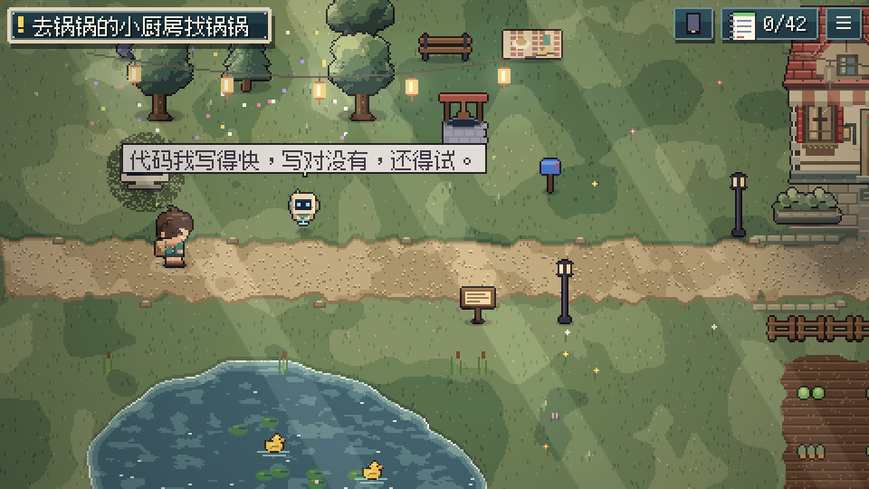
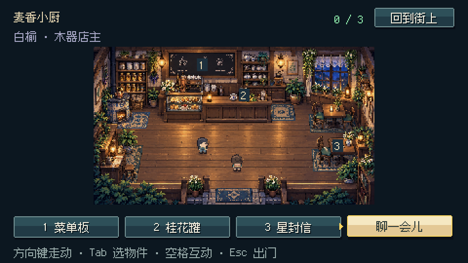
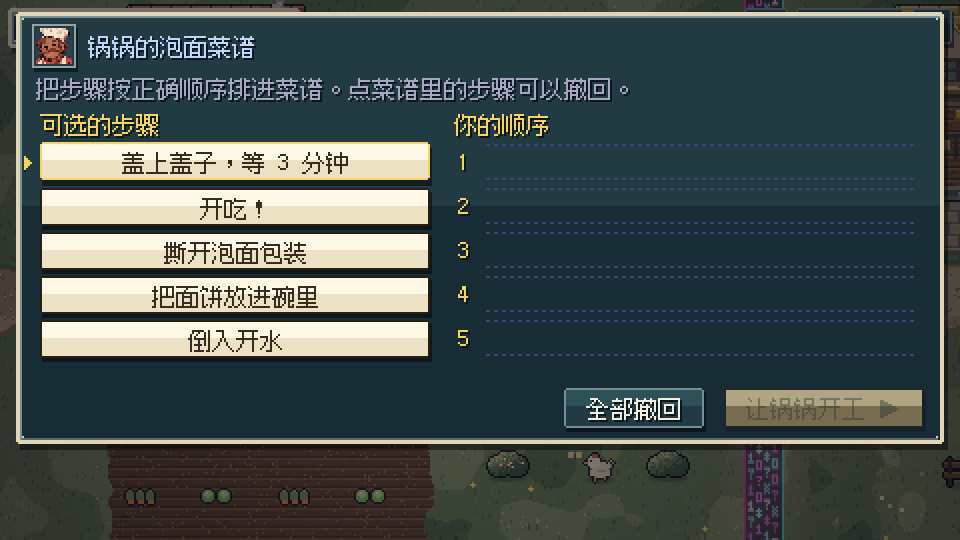
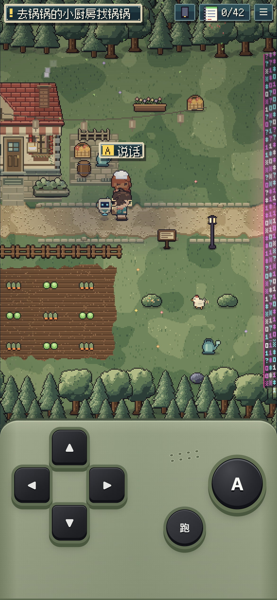

<p align="center"></p>

<h1 align="center">代码物语 · 星灯之约</h1>

<p align="center">和 AI 搭档修好一家小店，在像素小镇里完成你的第一次开发冒险。</p>
<p align="center">A story-driven pixel adventure about building with AI.</p>

<p align="center">
  <a href="https://buxiangai.com/game/"><strong>立即游玩</strong></a> ·
  <a href="https://github.com/YajunMonk/code-village/releases/latest">下载游戏</a> ·
  <a href="#游戏画面">游戏画面</a> ·
  <a href="#本地运行">本地运行</a> ·
  <a href="https://github.com/YajunMonk/code-village/issues">反馈问题</a>
</p>


## 今晚，星灯镇需要你

灯会就要开场，奶茶店的点单系统却坏了。

不会写代码的不响，和 AI 搭档小 A 接下了这份“修好管饭”的委托。你要问清店主的要求，理顺后厨的步骤，查明送不到的订单，再让镇外的客人也能打开点单页面。

《代码物语》是一款**中文像素叙事冒险，也是一份可以玩的氛围编程入门教程**。你会在对话、探索和小挑战里认识开发中的概念，练习向 AI 讲清需求、核对它的回答，以及把一个小想法逐步做成能用的东西。

**单人 · 简体中文 · 浏览器游戏 · 电脑与手机 · 无需账号**

## 你会玩到什么

- **一条贯穿五章的维修委托。** 从想清楚要做什么，到网页、网络、AI、工程和上线，27 个主线区域把开发流程串成一段旅程。
- **44 组互动练习与挑战。** 排菜谱、整理需求、核查消息、模拟终端、判断权限……42 个主线术语和 6 个隐藏术语随剧情收入图鉴。
- **可以进去的小镇。** 18 处室内、12 位原创居民、54 段物件故事。有人修灯，有人记账，也有人出门了，只留下一张纸条。
- **路上也有回应。** 猫、鸡、鸭、蝴蝶、花圃和长椅等 190 处轻互动，让赶路之间也有值得停下来的片刻。
- **一段随时可以接着走的冒险。** 本机自动存档、手动保存、JSON 导出与导入，支持把进度带到另一台设备。

游戏中的代码、订单、终端和部署是教学模拟。游玩不需要连接 AI 服务或提供 API Key；它帮助你理解开发过程，实际项目仍需要在开发工具中动手练习。

## 游戏画面

以下画面均截自仓库中的实际游戏。

| 灯会前的委托 | 在街道上寻找下一站 |
| --- | --- |
|  |  |

| 推开门，看看小镇的日常 | 把开发概念变成可以操作的练习 |
| --- | --- |
|  |  |

<details>
<summary><strong>手机竖屏：保留掌机式操作</strong></summary>
<p>手机使用方向键、A 键和跑步键；竖屏提供鼠尾草绿掌机底座，横屏使用轻量触屏按键。</p>

</details>

## 从点子工坊到发射台

| 章节 | 旅途中的问题 |
| --- | --- |
| 第一章 · 点子工坊 | 先做什么？怎样把需求说清楚，做出第一个小版本？ |
| 第二章 · 网络小镇 | 网页、后厨和仓库怎样分工，消息又怎样送达？ |
| 第三章 · AI 研究所 | 怎样给 AI 上下文，核对答案，安排它能做的事？ |
| 第四章 · 工程工坊 | 怎样保存版本、使用依赖、处理错误和合并冲突？ |
| 第五章 · 发射台 | 本地页面怎样成为网址，上线后又怎样接住问题？ |

主线之外，可以通过旅途手记回访地点、认识居民、查看图鉴和重看已解锁的剧情。

## 开始游玩

直接打开 **[buxiangai.com/game/](https://buxiangai.com/game/)**。原来的 [GitHub Pages 地址](https://yajunmonk.github.io/code-village/) 也提供同一版本。

| 操作 | 电脑 | 手机 |
| --- | --- | --- |
| 走动 / 跑步 | 方向键或 WASD / Shift | 方向键 / 跑步键 |
| 对话、进屋、确认 | 空格或 Enter | A 键，或点附近人物、房门 |
| 对话翻页 | 空格或 Enter | 点对话框 |
| 室内探索 | 方向键、Tab / C 选物件 | 点地板、物件标记或人物 |
| 旅途手记 / 图鉴 | Q / C | 菜单中的手记 / 右上角图鉴 |
| 暂停、保存、设置 | Esc | 右上角菜单 |

故事可以慢慢读。部分挑战有局部计时，失败后可以重试。

### 存档与换设备

进度保存在**当前设备、当前浏览器、当前网站地址**中，手机和电脑各自保存。

换设备时，在「设置与存档」中**导出备份**，把 JSON 文件传到另一台设备，再选择文件、核对预览并确认导入。导入前会保留一份旧进度，可从同一面板恢复。不同网址之间也可以这样迁移。

完整说明见 [存档与常见问题](docs/SAVES.md)。当前没有账号、云端自动同步或完整 PWA 离线安装。

## 本地运行

已经提交可运行的网页包，**游玩不需要 Node.js、npm 或构建工具**。安装 Python 3 后：

```sh
git clone https://github.com/YajunMonk/code-village.git
cd code-village
python3 scripts/serve.py --open
```

Windows 可以将最后一行的 `python3` 换成 `py -3`；macOS 也可以双击 `启动代码物语.command`。打开 **http://127.0.0.1:4173/** 即可。

想下载而不克隆仓库，可在 [Releases](https://github.com/YajunMonk/code-village/releases/latest) 获取网页包或离线单文件版。网页包需保留 `index.html` 与 `assets/` 的相对位置；长期游玩推荐固定的 HTTP 地址，以便稳定读取存档。

## 开发与构建

游戏采用原生 **JavaScript + Canvas 2D + Web Audio**，Python 负责构建与本地服务。游戏运行时无需后端；图片和字体随包提供，音乐与音效由代码合成。

```text
index.html              可直接运行的构建入口
assets/                 当前版本的 WebP、PNG 图标与构建清单
source/src/             游戏逻辑、剧情、界面与样式
source/assets/          正式美术源图、字体与素材配置
scripts/                本地启动、构建检查、游戏回归与发行打包
docs/                   构建、存档、素材说明与游戏截图
```

重新构建需要 **Python 3.10+、FontTools、Brotli 和 cwebp**：

```sh
python3 -m venv .venv
.venv/bin/python -m pip install -r requirements-build.txt
.venv/bin/python source/build.py
```

Windows 的虚拟环境解释器为 `.venv\Scripts\python.exe`。`cwebp` 需另行安装；环境准备、离线构建、检查与部署见 **[构建指南](docs/BUILDING.md)**。

发现卡关、错别字或显示问题，欢迎提交 [Issue](https://github.com/YajunMonk/code-village/issues/new/choose)。参与修改前请阅读 [贡献指南](CONTRIBUTING.md)。

## 制作与素材

由 [王不响 / YajunMonk](https://github.com/YajunMonk) 制作，基于本仓库最初的「代码村大冒险」demo 持续开发，旧提交历史保留。

像素原画与角色图集使用 AI 辅助生成，游戏中的居民对白为原创；字体使用 Fusion Pixel，完整 OFL 许可随仓库和发行包保留。代码与美术尚未指定统一开源许可证，复用前请联系作者。详细来源见 [制作与素材说明](docs/CREDITS.md)。

版本变化见 [CHANGELOG](CHANGELOG.md)。
